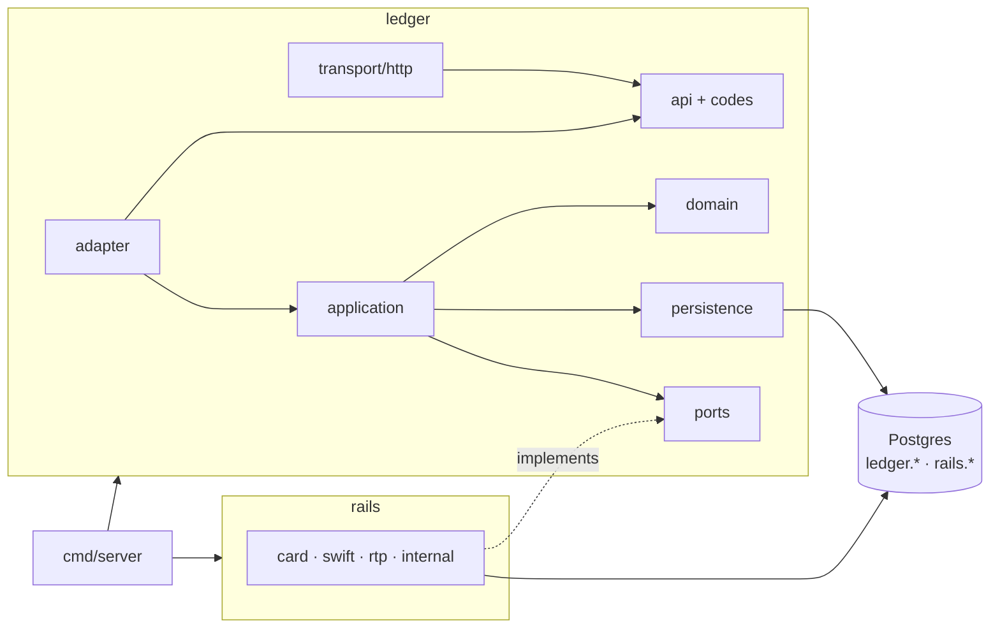

# fintech

A double-entry ledger in Go, built as a modular monolith: money moves through
balanced, append-only transactions, and external payment rails (simulated
card, SWIFT and instant bank transfers) sit behind a port the ledger owns.

> **Not production software.** There is no authentication, the payment rails
> are simulators, and there are no metrics yet. It is a study in getting the
> money path right: idempotency, holds, refunds, and keeping a ledger and an
> external rail from silently disagreeing.

## What it does

- **Double-entry, append-only.** Every transaction balances; entries can never
  change and transactions can never be deleted (enforced by database triggers).
- **Idempotent writes.** Every write takes an idempotency key; a retry returns
  the original result, a reused key with a different request is rejected.
- **Holds.** Reserve funds, capture all or part, void the rest, or let them
  expire. Available balance accounts for outgoing holds.
- **Reversals.** Full or partial refunds, never past the original's total.
- **Rails.** Internal transfers, instant irreversible rails (Raast, SARIE),
  card (authorize, settle later, cancel, refund) and SWIFT (slow, can bounce).
- **Two-phase rail outcomes.** The rail decides, the ledger applies, then
  acknowledges. A crash between the two is finished by the next run.
- **Reconciliation.** A report and a scheduled job compare every rail attempt
  with the ledger and name each kind of disagreement.

## Architecture



- Each module owns a Postgres schema; no SQL ever joins across them.
- One repository, modular monolith. Other modules, and other repositories,
  use the ledger only through `ledger/api`; rails implement `ledger/ports`.
  Everything else is under each module's `internal/`, which the compiler
  keeps private. A module moves to its own repository when a second consumer
  needs a different release cadence, not before.
- The dependency rules are tested: `internal/archtest` fails the build when a
  layer reaches somewhere it should not.

Read [docs/ARCHITECTURE.md](docs/ARCHITECTURE.md) for how it works and the
decisions behind it. [docs/stories](docs/stories/README.md) is the build
journal: why it ended up this way, one story at a time, with five picked as
the place to start. The best single read is the "Found on first run" section
of [story 21c](docs/stories/021c-reconciliation.md): the reconciler's first run
found a real bug in a migration written two stories earlier.

## Run it

Requires Go 1.26 and Docker.

```bash
make up      # Postgres in Docker
make run     # migrates, seeds system accounts, serves on :4000
```

```bash
# open two accounts
curl -s localhost:4000/accounts -d '{"owner_type":"system","owner_id":"cash","currency":"PKR","type":"asset"}'
curl -s localhost:4000/accounts -d '{"owner_type":"customer","owner_id":"ali","currency":"PKR","type":"liability"}'

# top up Ali by card: comes back pending until the card rail settles it
curl -s localhost:4000/transactions -d '{
  "kind": "topup", "rail": "card", "idempotency_key": "topup-1",
  "entries": [
    {"account_id": "<cash id>", "amount": 5000, "direction": "debit"},
    {"account_id": "<ali id>",  "amount": 5000, "direction": "credit"}
  ]}'

curl -s localhost:4000/accounts/<ali id>/balance
curl -s localhost:4000/admin/reconciliation
```

| Endpoint | |
|---|---|
| `POST /accounts`, `GET /accounts?owner_type=&owner_id=`, `GET /accounts/{id}` | accounts |
| `GET /accounts/{id}/balance`, `GET /accounts/{id}/transactions` | balance, statement |
| `POST /transactions`, `GET /transactions/{id}` | post, read |
| `POST /transactions/{id}/reverse` · `/capture` · `/void` | refund, settle a hold, release a hold |
| `GET /admin/balances/verify`, `POST /admin/balances/rebuild` | balance cache |
| `GET /admin/reconciliation` | rail vs ledger report |

Amounts are integers in minor units.

## Test

```bash
make test
```

Tests run against a real Postgres in their own database (`fintech_test`,
created on first run), with the race detector on.

## Layout

```
cmd/server/            binaries: the composition root
ledger/                the ledger module: api, codes, ports, migrations, internal/
rails/                 rail simulators implementing the ledger's ports
platform/              shared infrastructure: database, errors, http helpers, scheduler
internal/archtest/     dependency-rule tests, private to this repository
docs/                  architecture and the build journal
```

Every other top-level folder is a business module with the same shape.

## Roadmap

v0.1.0 is the ledger and its rails. The verticals arrive as modules in this
repository, each depending on the others only through their `api/`:

- **Build 2, wallet and compliance:** `identity` (users, KYC states, tiers),
  `limits` (per-tier caps checked before posting), `wallet` (top-up, P2P by
  phone, pay merchant), `risk` (rule engine: allow, review, block),
  `disputes` (chargebacks as rail-initiated reversals), authentication
- **Build 3, marketplace and lending:** `settlement` (multi-leg orders,
  merchant payouts, clawback after chargebacks), `lending` (BNPL: credit
  lines, installment schedules, collection), `promotions` (vouchers, cashback)
- **Capstone:** an outbox so rails are called after the ledger commits,
  domain events, reconciliation against provider settlement files,
  reporting, observability, load numbers
- **Build 4, distributed:** the same `api` interfaces served over gRPC from
  separate binaries, events through Kafka, sagas with reversal as compensation
